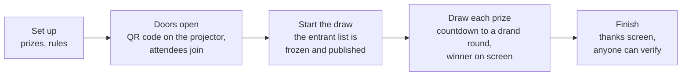
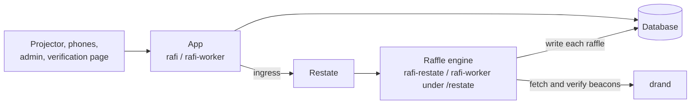

# Rafi

**Live, verifiable raffles for meetups.**

Attendees scan a QR code and join on their phone with a display name and email. There's no app to install and no
account to create. The organizer draws each prize live on the projector. Every draw commits to public
[drand](https://drand.love) randomness *before that randomness exists*, so nobody, the organizer included, can
predict or steer a result. Anyone can re-run every draw afterwards.

## Why

Raffles at meetups are usually run with a hat, a spreadsheet or a random-name website, and each has the same
problems:

- **You have to trust whoever runs it.** When a sponsor's friend wins, people wonder.
- **Entry is friction.** Paper slips get lost, apps need installing, accounts need creating.
- **Venues are hard.** The wifi is bad, phones go to sleep, and some people have no smartphone.
- **Winners aren't always there.** No-shows are the most common live failure, and redrawing by hand looks
  arbitrary.

Rafi makes the draw **verifiable by anyone** and keeps everything else as light as possible: a web page, a name, an
email, a claim code.

## How an evening goes



There are four screens:

| Screen | Path | |
|---|---|---|
| **Projector** | `/s/<slug>` | Intro, prizes, QR code, live entrant count, countdown, winner reveal. Never shows emails or admin controls. |
| **Participant page** | `/j/<CODE>` | Server-rendered, so it works on bad venue wifi. It shows "YOU WON!" with a private claim code. |
| **Organizer admin** | `/admin` | Raffles, prizes, people without a smartphone, the draw console (Draw / Handed over / Not here / Declined), CSV export |
| **Verification** | `/v/<slug>` | Re-runs every draw in the browser. [`tools/verify.py`](tools/verify.py) does the same independently. |

## Why you can trust the draw

1. **The list is fixed first.** Starting the draw freezes the entrants (as anonymous IDs) and the prizes into a
   *manifest*, and publishes its hash.
2. **Each draw commits to the future.** Pressing Draw picks a drand round about 6 seconds ahead and shows it on the
   projector. Nobody, Rafi included, can know that round's value until the drand network publishes it.
3. **The winner is a public formula** of the manifest hash, the round's randomness and the draw number. drand's
   randomness is a threshold BLS signature by independent organizations, which anyone can verify. So anyone can
   recompute every winner.

The commitment is final: if drand can't be reached, a draw waits on its round rather than picking a new one. Every
redraw ("Not here", "Declined") and every abandoned draw is in the public log.
[Why the draw is verifiable](docs/explanation/verifiability.md) has the details and the limits.

## Components



| Component | What it does | Native | Cloudflare Workers |
|---|---|---|---|
| **App** | The HTTP server and the web app: pages, APIs, every use case. Keeps no state between requests. | `rafi` | `rafi-worker` |
| **Raffle engine** | Owns each raffle from freeze to finish and runs its draws, as a [Restate](https://restate.dev) virtual object. Sees only anonymous IDs. | `rafi-restate` | `rafi-worker`, under `/restate` |
| **Database** | The record, shared by the app and the engine | SQLite or Postgres | D1 |
| **Web app** | Admin, projector, verification page (Dioxus) | `rafi-web` | same |
| **Participant script** | Keeps the participant page live (WebAssembly, with a JavaScript fallback) | `rafi-participant` | same |

At the core is [`crates/raffle`](crates/raffle): the raffle's rules, the draw algorithm and the verifier, in pure
Rust with no I/O. A manifest and an engine are enough to run a raffle, and nothing of the app is needed to verify
one. [Architecture](docs/explanation/architecture.md) explains the rest.

## Status

- **Self-hosting** (native `rafi` and `rafi-restate`) works today. There are no packaged images yet: you build from
  source.
- **Cloudflare Workers** is the planned production deployment. It is verified locally under `wrangler dev`, but not
  deployed yet.
- The UI is in English only.

## Documentation

**Using Rafi**
- [Running a raffle](docs/guide/running-a-raffle.md): an evening, from setup to erasure
- [The draw](docs/guide/the-draw.md): the draw process, step by step
- [For participants](docs/guide/for-participants.md)
- [Verifying a draw](docs/guide/verifying-a-draw.md)

**Understanding Rafi**
- [Why the draw is verifiable](docs/explanation/verifiability.md): drand, commit-reveal, the threat model
- [Architecture](docs/explanation/architecture.md)
- [Privacy and abuse](docs/explanation/privacy-and-abuse.md)

**Operating Rafi**
- [Overview](docs/operations/overview.md): what you deploy, and the topologies
- [Self-hosting](docs/operations/self-hosting.md) · [Cloudflare Workers](docs/operations/cloudflare.md)
- [Upgrades](docs/operations/upgrades.md) · [Troubleshooting](docs/operations/troubleshooting.md)

**Reference**
- [Draw algorithm](docs/reference/draw-algorithm.md) (`rafi-draw-v1`)
- [Configuration](docs/reference/configuration.md) · [Routes](docs/reference/routes.md)
- [Glossary](docs/reference/glossary.md) · [Crates and apps](docs/reference/crates.md)

**Developing Rafi**
- [Getting started](docs/development/getting-started.md) · [Testing](docs/development/testing.md) ·
  [The web app](docs/development/web-app.md)
- [Design history](docs/history): the notes written during development, with the reasoning behind decisions.
  These are historical: the code is the source of truth.

## Quick start

With [devenv](https://devenv.sh), everything (Restate, the raffle engine, the server and the web app, with dev auth
and live reload):

```sh
devenv up                                   # open http://localhost:8787/admin
```

`devenv --profile mock up` works offline, `devenv --profile workers up` runs it on Cloudflare Workers, under
`wrangler dev`, and `--profile clerk` signs in with Clerk (keys in `.env`). Without devenv, and for phones and
everything else, see [Getting started](docs/development/getting-started.md).

## License

Licensed under either of

- Apache License, Version 2.0 ([LICENSE-APACHE](LICENSE-APACHE) or <http://www.apache.org/licenses/LICENSE-2.0>)
- MIT license ([LICENSE-MIT](LICENSE-MIT) or <http://opensource.org/licenses/MIT>)

at your option.

### Contribution

Unless you explicitly state otherwise, any contribution intentionally submitted
for inclusion in the work by you, as defined in the Apache-2.0 license, shall be
dual licensed as above, without any additional terms or conditions.
