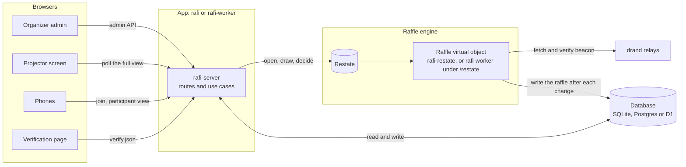
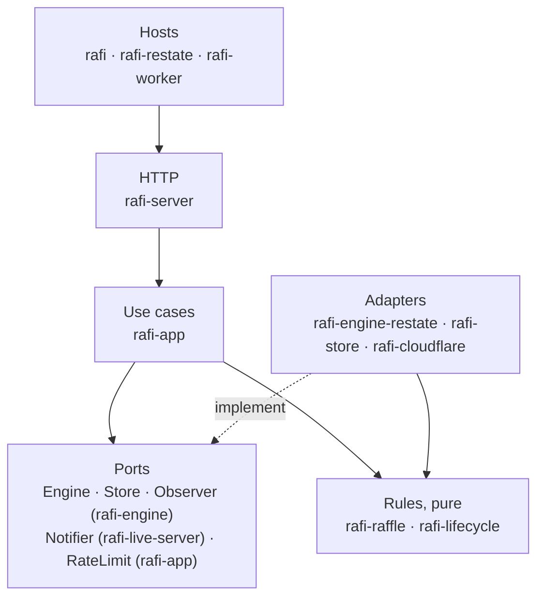
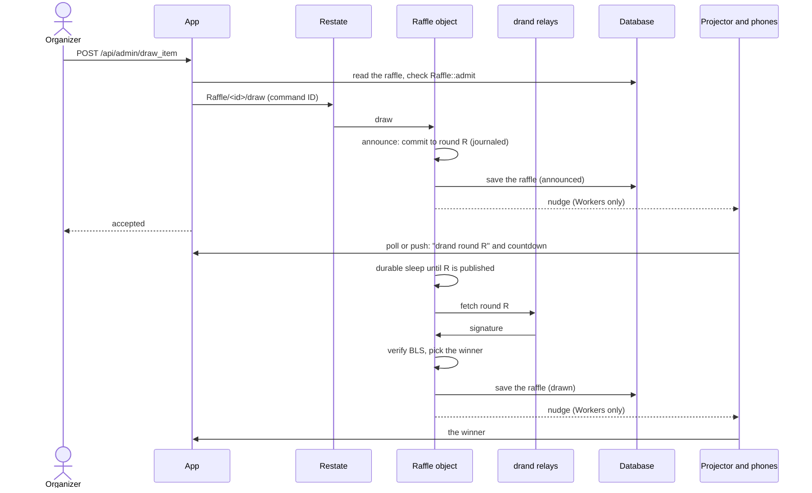
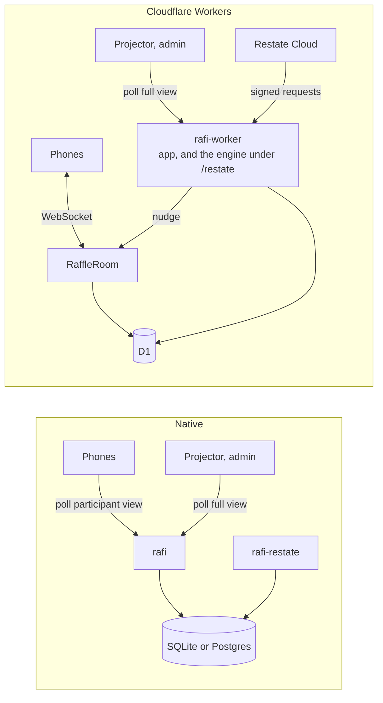

# Architecture

How Rafi is put together, and why. For the list of crates, see [Crates and apps](../reference/crates.md). For
deploying it, see [Operations](../operations/overview.md).

## The big picture

Rafi has three moving parts around one database:

- **The app**: a stateless HTTP server plus a web app. It serves the organizer's admin, the projector screen, the
  participant page and the verification page, and runs every use case: creating raffles, joining, starting the draw,
  and so on.
- **The raffle engine**: owns each raffle from the moment its list is frozen until it finishes, and runs its draws.
  It is a [Restate](https://restate.dev) virtual object, `Raffle`, one per raffle. It only ever sees anonymous IDs.
- **The database**: the record. The app writes raffles, prizes and entrants. The engine writes each raffle's event
  log after every change. Everything reads from it.

## Layers

The rules are pure code at the bottom. Everything above them does I/O and asks the rules what is allowed.

- **`rafi-raffle`** is the raffle itself: the manifest, the state machine, the draw algorithm and the verifier. A
  manifest and an engine are enough to run a whole raffle. It knows nothing about the app, and the browser's
  verification page runs the same code.
- **`rafi-lifecycle`** is what the app adds around a raffle: draft, published, registration, starting the draw,
  entrants, settings. From the freeze on, the lifecycle follows the raffle.
- **`rafi-app`** holds the use cases, over small interfaces (ports). Each deployment plugs in its own engine
  client, database, live-update notifier and rate limiter. Cloudflare is one deployment, not an assumption of the
  code.
- The server tells the admin UI what it may do next (`actions`). The UI derives no rules of its own.

## Why a separate raffle engine, and why Restate

A draw is a small distributed protocol: commit to a round, wait for it, fetch it, verify it, record the result. The
fairness argument depends on that commitment being **final**. If a crash halfway through could lead to a new round,
someone could "reroll" a draw. Restate provides what this needs:

- **Durable execution.** The committed round is journaled before the engine sleeps until it's published. A crash or
  redeploy replays to the same round and the same winner.
- **One command at a time per raffle.** A virtual object keyed by the raffle's ID runs its handlers one at a time,
  so a "Not here" can't slip in while a draw is pending. A decision sent mid-draw queues behind it.
- **Idempotency.** Every command carries an ID and applies once, so retrying after a timeout is always safe.

There is deliberately **no fallback engine** in production. Two engines owning one raffle could announce one draw
on two rounds. If the engine is unreachable, the app refuses to start a draw, and a stalled draw waits for it. The
in-process `LocalEngine` exists for tests and development only.

The app talks to the engine only through the `Engine` interface (`info`, `open`, `draw`, `decide`; the object
also answers `get`, the current raffle, for recovery and debugging), documented in
[`crates/engine/src/engine.rs`](../../crates/engine/src/engine.rs). Its contract:

- State is read from the database (the projection), never from the engine.
- Opening is idempotent per manifest. A different manifest, or a different drand chain from the engine's, is refused.
- Draws are accepted asynchronously, and decisions apply synchronously.
- Commands for one raffle apply in order, one at a time.
- A command ID applies once.
- After the raffle finishes, the engine forgets it.

The [engine conformance suite](../development/testing.md#engine-conformance) checks this contract on every engine.

The app decides which drand chain raffles commit to (`RAFI_DRAND_CHAIN`). Before starting a draw it asks the
engine which chain it draws from, and refuses on a mismatch.

## A draw through the system

If the fetch fails or times out, the engine records `stalled` instead and the draw stays pending on round R. See
[The draw](../guide/the-draw.md#when-drand-cant-be-reached).

## Who owns what

| Data | Owner |
|---|---|
| Raffles, prizes, entrants (personal data), consents, claim codes, token hashes, the audit log | The database, written by the app. Personal data never leaves the app. |
| The manifest and its hash | The database, written by the app when the list is frozen, before the raffle opens in the engine |
| The raffle's event log, and its completed draws | The database, written by the engine after every change. The log is append-only, and triggers refuse updates, deletes and gaps. |
| The live raffle | The engine (Restate object state), from opening to finish. Then it forgets it. |
| The participant view | Rebuilt from the database. On Workers, the raffle's `RaffleRoom` caches and pushes it. |

## Live updates

The server keeps no state between requests. Clients keep up in one of two ways:

- **Natively**, phones poll their participant view (`/api/r/<slug>/participant`), and the projector and the admin
  poll the full view (`/api/r/<slug>/view`) every few seconds.
- **On Cloudflare Workers**, a Durable Object per raffle (`RaffleRoom`) holds a live channel. The app nudges it on
  lifecycle changes, and the engine nudges it after every raffle write. It then pushes the participant view to
  phones over WebSockets. The projector and the admin still poll the full view, and also reveal the winner from the
  channel.

Both views carry the raffle's version (`v`) from the database, so a client never goes back to an older view. Phones
re-fetch whenever they come back from the background.

Natively the app and the engine are two processes, `rafi` and `rafi-restate`, each with its own configuration.
On Workers they are one Worker: a Worker is a routing unit, not a process, and the two shared everything that
costs anything (the D1 binding, the Durable Object namespace, the deploy). Restate reaches the engine at
`/restate/*`, where the SDK verifies each request's signature before any routing, discovery included. The
boundary that matters, the engine seeing anonymous IDs only and writing through a store API that exposes nothing
else, is in the code, not in the process.

## The participant page

Phones get a server-rendered page (`/j/<CODE>`), so it works on poor venue wifi and without the web app. A small
WebAssembly module, with a JavaScript fallback, keeps it live, solves the join proof-of-work and plays the
"you won" moment. The entry lives in an HttpOnly cookie, and only its hash is stored. See
[Privacy and abuse](privacy-and-abuse.md).

## Where to read next

- [Why the draw is verifiable](verifiability.md)
- [Crates and apps](../reference/crates.md)
- [Operations overview](../operations/overview.md)
- [`docs/history/`](../history): the design notes from development, with the reasoning behind many decisions.
  These are historical: the code is the source of truth.
