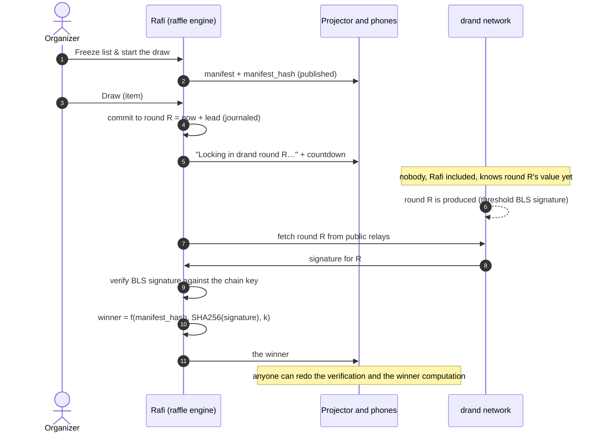

# Why the draw is verifiable

A raffle is only as fair as people believe it is. Usually you have to trust whoever holds the hat, or whoever runs
the app. Rafi is built so that nobody has to be trusted to pick the winner, the organizer and the server's operator
included. Anyone can check every draw afterwards.

This page explains the idea, what [drand](https://drand.love) contributes, the rules that make it work, and the
limits of what it proves. The exact algorithm is in the [reference](../reference/draw-algorithm.md). To check a
raffle yourself, see [Verifying a draw](../guide/verifying-a-draw.md).

## The idea: commit first, reveal later

A fair draw needs randomness that **nobody knows in advance and nobody can choose**. Rafi gets it with a
commit-reveal scheme in three steps:

1. **Fix everything except the randomness, and publish it.** When the organizer starts the draw, the entrant list
   is frozen into a **manifest**: anonymous entrant IDs, the items to win, the algorithm, and where the randomness
   will come from. Its hash is published.
2. **Commit to randomness that doesn't exist yet.** Each draw names a future drand **round**, a few seconds ahead,
   and shows it on the projector before that round is published.
3. **Compute the winner with a public formula.** Once the round is out, the winner is a deterministic function of
   the manifest, the round's randomness and the draw number. Anyone can recompute it.

Nobody can steer the outcome. Before the round, nobody knows its value. After it, the result is already fixed.

## What drand adds

[drand](https://drand.love) is a public randomness beacon run by the League of Entropy, a group of independent
organizations (universities, companies and foundations). Rafi uses its **quicknet** chain, which publishes a new round every 3 seconds.

Each round is a **threshold BLS signature** over the round number. Every member holds a share of the network's
key, and a round only exists once enough members have contributed their shares. This gives Rafi four properties it
couldn't get on its own:

| Property | Why it holds | What it means for a raffle |
|---|---|---|
| **Unpredictable** | A round's signature can't be computed until a threshold of independent members sign it, at its scheduled time | Nobody knows who a draw picks until its round is out |
| **Unbiasable** | A BLS signature is unique: for a given key and round there is exactly one valid signature | Nobody can try several random values and keep the one they like, not even the drand members |
| **Publicly verifiable** | Anyone can check a signature against the chain's public key | You don't have to trust Rafi, or the relay it fetched from, about the randomness |
| **Independent** | The network is run by many organizations, and none of them is the raffle's organizer or operator | The randomness doesn't come from the party you'd suspect |

Without drand, the randomness would come from the server (`rand()`), and you'd have to trust the server. With drand,
the server only *transports* randomness. It can't create it, predict it or forge it.

The randomness for a draw is `SHA256(signature)`. Rafi verifies every beacon before using it, and so does the
verification page in your browser. drand relays are just HTTP mirrors: a lying relay is caught by the signature
check.

## The rules that make it work

drand alone isn't enough: the protocol around it has to give nobody room to cheat. Each rule closes a specific gap.

**The list is frozen and published before any draw.** The manifest (entrants, items, algorithm, chain) is written
when the organizer starts the draw. Every draw's seed includes the manifest's hash. Adding or removing anyone
afterwards changes the hash, and verification fails.

**Each draw commits to a round that doesn't exist yet.** The round is at least one drand period after the request
(6 s by default), and the projector and the phones show it with a countdown before it's published.

**The commitment is final.** The raffle engine runs on [Restate](https://restate.dev), which journals the committed
round before waiting for it. If the engine crashes or is redeployed mid-draw, it replays to the *same* round and the
same winner. If the beacon can't be fetched, the draw **stalls** on its round. Pressing Draw again fetches the same
round, never a new one, so nobody can "reroll" by pretending drand was down.

**Nothing changes a pending draw's pool.** While a draw waits for its round, every other change that could affect
whom it picks is refused: another draw, "Not here", "Declined", withdrawing its item, finishing.

**The selection is deterministic and unbiased.**
`seed = SHA256("rafi-draw-v1" ‖ randomness ‖ manifest_hash ‖ k)`, and the winner index comes from SHA-256 counter
mode with rejection sampling, so there is no modulo bias. Including `k` (the draw number) means two draws never
share a seed. Including the manifest hash ties each result to this raffle and this list.

**Every remaining lever is public.** "Not here", "Declined", "Withdraw" and abandoning a stalled draw are all
recorded in the event log, which the verification page shows. A forfeited winner is a real person in the room. For
an abandoned draw, anyone can see whom its round *would* have picked.

**One win per person.** Once drawn, an entrant leaves the pool whatever the outcome. Only if there are more items
than people does a second pass draw again from earlier winners who didn't forfeit.

## What verification proves

The [verification page](../guide/verifying-a-draw.md) and [`tools/verify.py`](../../tools/verify.py) check that:

- the published manifest hashes to the published hash, and is valid and canonical
- every beacon is a genuine drand signature for its round (the page checks BLS; `verify.py --fetch` compares
  each signature with the public relays')
- every draw picked exactly the entrant the algorithm dictates, from exactly the pool the rules dictate, on the
  round it announced
- the log follows the rules: no silent round switches, no forfeits while a draw is pending, no draw without an
  announcement

## Threat model and limits

Verifiability is a strong claim, so here is where it ends.

| Who | Could they… | Result |
|---|---|---|
| Organizer | …pick a round whose value they know? | **No.** The round is in the future and announced live. |
| Organizer | …press Draw at a "good" moment? | **No effect.** The value of a future round is unknown whenever you press. |
| Organizer | …draw the items in a convenient order? | **No effect.** Each draw's randomness is unknown when its item is picked. |
| Organizer | …redraw until a friend wins? | **Only in public.** The only way to redraw an item is to forfeit its winner ("Not here", "Declined"). That happens in front of the room and stays in the log, and the forfeited person is out. |
| Organizer or operator | …block drand so a draw stalls, look at the now-public round, and abandon it if the winner is "wrong"? | **Possible, but visible.** This is the one remaining lever. Every abandon is logged, and the verifier shows whom the abandoned round would have picked. Treat an abandon as something the organizer should explain. |
| Operator | …edit the log or the manifest afterwards? | **Detected.** The manifest hash, the BLS signatures and the replay all have to match. |
| Operator | …forge a beacon? | **No.** That would mean forging a threshold BLS signature. |
| Organizer | …add people before the freeze? | **Not prevented by cryptography.** Before the freeze the list is the organizer's to manage: removing duplicates, adding people without a phone, and in test mode, adding fake entrants. Switching test mode off doesn't remove fakes. The projector shows the live count, and the published data (`verify.json`) maps every entrant to a display name until personal data is erased, so attendees can check who is in. |
| Entrant | …enter many times? | **Hard.** There is one entry per email address, a proof-of-work on joining, and rate limits. Winners must be present to claim, so remote or invented entries forfeit. |
| drand | …a threshold of League of Entropy members colluding? | **Out of scope.** This is drand's trust assumption. |

There is one more limit, which is about **timing**. The log records which round each draw committed to, but it
can't prove *when* that commitment was made. That is witnessed live: the projector and every phone show
"Locking in public randomness · drand round R" with a countdown *before* round R is published. The same goes for the
manifest: the verification page publishes its hash from the moment the list is frozen. If you want to hold the
organizer to it, note the manifest hash before the first draw and the round numbers as they're announced (a photo
of the projector will do), then check that the published log matches.

## Further reading

- [The draw, step by step](../guide/the-draw.md): the same process from the organizer's side
- [Draw algorithm reference](../reference/draw-algorithm.md)
- [drand documentation](https://docs.drand.love/)
- [Architecture](architecture.md): how the raffle engine and Restate fit in
