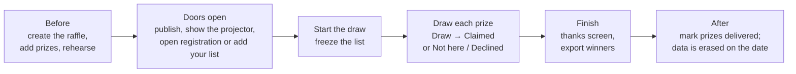
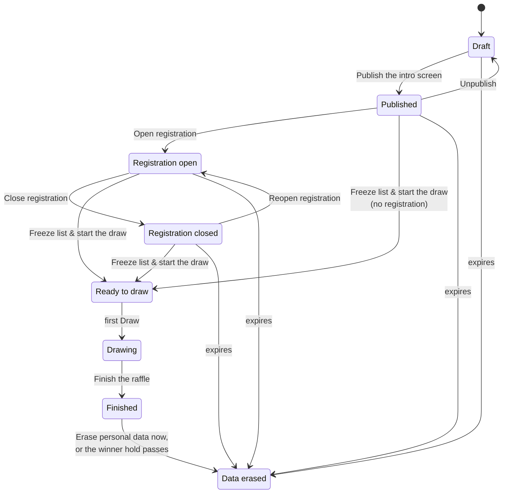

# Running a raffle

A walkthrough of one evening, from setting up to erasing data afterwards. It assumes a running Rafi. To deploy one,
see [Operations](../operations/overview.md). For the draw itself in detail, see [The draw](the-draw.md).

## The evening at a glance

Your screens:

| Screen | Where | Shown to |
|---|---|---|
| **Admin** | `/admin` | You. Keep it on a laptop or phone, never on the projector. |
| **Projector screen** | `/s/<slug>` ("Projector screen" button) | The room. It never shows emails or admin buttons. |
| **Participant page** | `/j/<CODE>` (the QR code) | Each attendee, on their phone |
| **Verification page** | `/v/<slug>` ("Verification page" button) | Anyone, once the list is frozen |

## The raffle's states

The admin shows a state badge and the next steps. Each state allows different things:

A raffle that was never frozen **expires** when its erasure date passes, whatever its state: its entrants are
deleted outright and it becomes Data erased. A raffle [without registration](#raffles-without-registration) never
opens: it goes from Published to the freeze.

| State | Prizes and entrants editable | Registration switchable | Phones can join | Draws |
|---|---|---|---|---|
| Draft, Published | yes | yes | no | no |
| Registration open | yes | no (close it first) | **yes** | no |
| Registration closed | yes | yes | no | no |
| Ready to draw, Drawing | no (only withdraw an item) | no | no | **yes** |
| Finished, Data erased | no | no | no | no |

## Before the event

0. **The first time:** read the service's terms (`/terms`), which include the data processing agreement. Your
   entrants' data is processed on your behalf; the terms say how, and you accept them by using the service. In a
   Clerk organization, **managers** (a custom `org:manager` role, or the `org:raffles:manage` permission, set up
   in Clerk) create, configure and delete raffles; every **member** runs them: registration, the draw, people,
   prizes, exports, erasure; an **admin** can also remove the organization's data.
1. **Create a raffle** in `/admin`: give it a title and the **event date** (today, unless you set it up early; at
   most a year ahead). Entrants' personal data is erased a set number of days after it, and the join form tells
   them the date, so the date and the period lock once a real entrant has joined. Fake entrants don't lock
   anything; someone you add by hand, or your own phone, does. Remove the real entrants (People tab, before the
   freeze) to unlock.
2. **Settings:** the description for the intro screen, the organizer (named as data controller in the rules and
   privacy notice) and a contact email, both needed before registration can open; optionally a separate privacy
   contact (a DPO), your own privacy text or a link to your own privacy notice, shown after the generated notice;
   the **retention period** (how many days after the event non-winners are erased: the service's default, 7,
   unless you choose otherwise, at most 30); and any **additional rules**, one paragraph per line. Put a higher age
   limit there (the service's minimum is in the standard rules, and the join form says the rules may ask for
   more). **Let people join with the QR code** is on unless you switch it off: off, the raffle has no registration
   and its entrants are the people you add ([below](#raffles-without-registration)). Save them as **your
   defaults** so the next raffle starts with them.
   - **Adding people from a guest list?** Tell them before the event. Under the privacy fields, the settings show
     **What to tell the people you add**: a paragraph to copy onto the event page or into the confirmation email,
     and edit as you like. It says they are in your prize draw, that their name is shown on the event screen and
     the public results page (pick full names or first name and initial to see how it reads), links the raffle's
     rules and privacy notice (and your own notice, if it is an `https://` link), and asks anyone who'd rather not
     take part to tell your privacy contact (or your contact email) before the draw. The links work once the raffle
     is published. You're responsible for being allowed to share the list, for telling its people, and for their
     meeting the age limit: the rules and the terms say so. Don't add a list that says something about people's
     health, beliefs, politics or sexuality just by having them on it (a support group's, a religious or political
     meeting's attendees): let them join with the QR code there.
3. **Prizes:** add each prize with a quantity and, optionally, a sponsor. Each copy is drawn on its own, in any
   order you like during the draw. Say how each one reaches its winner: **On the spot** (handed over when they
   come up with their code: pressing **Claimed** marks it delivered too) or **Sent later** (a voucher you email
   afterwards: you mark it delivered once it reached them, and the winner's phone says it will be sent). This
   one setting can still change after the freeze, until the raffle is finished.
4. **Rehearse.** Turn on **Test mode** in settings. A TEST badge shows on every screen, and the People tab offers
   **Add 25 fake entrants**, with generated names like "Brave Otter". Run through the draw on the projector.

> Rehearse on a copy: **Duplicate** (the raffle's ⋯ menu) copies prizes and settings but not entrants, dates the
> copy today (set its event date), and a raffle drawn in test mode stays a rehearsal: its verification page says
> **TEST MODE** for good. To rehearse on the raffle you'll run live, switch test mode off before the freeze: that
> removes every fake entrant. A raffle that isn't in test mode never freezes with fakes in it.
>
> **Postponed?** The event date is locked once a real entrant has joined, and the data is erased on the date they
> were told. Before the freeze, remove the real entrants to unlock the date, or duplicate the raffle for the new
> date and have people join again. After the freeze, the only option is a new raffle.

## When doors open

1. **Publish the intro screen.** Open the **Projector screen** on the venue's display, in fullscreen (which also
   keeps the screen awake). It shows the title, the prizes and "Registration opens soon".
2. **Open registration.** The projector now shows a QR code, the short join URL and code, a live entrant count and
   recent names, plus "No smartphone? Come to the organizer!". Once you have added people from a list, it says
   "Registered? You're already in. Not registered? Scan to join." instead of "Scan to join", so your registrants
   don't join a second time. A raffle [without registration](#raffles-without-registration) has no such step.
3. Attendees scan and join with their email and a display name, which is optional: whoever leaves it blank gets a
   generated one, like "Brave Otter" (see [For participants](for-participants.md)).
4. While people join, use the **People** tab to:
   - **Add people → One person**: by name (email optional), for someone without a phone or anyone you put in
     yourself. They are in the draw like everyone else, as "added by you"; an email already in is skipped. **Undo
     last add** takes your latest add off the list again, until the freeze. A name you give may be a full name of
     up to 64 characters (people joining with the QR code have 24): the projector fits it on screen. It can't be a
     name someone in the raffle is already shown with ("Someone is already shown as “Anna K.”"): add a surname, an
     initial or a number, so the room can tell who won. The word filter matches parts of words and refuses some
     real names (Nazir, Buzinkay): if it refuses someone's real name, switch on **It's their real name** to add it
     anyway; nothing else is lifted.
   - **Add people → Paste or upload a list**: your guest list, in one go ([below](#adding-a-list)).
   - **hide** or **rename** a display name on screen with one tap (a troll, a typo), up to 64 characters. New names
     reach the projector after a 5 s delay.
   - **remove** duplicates, or someone who asked to be taken off: switch on **They asked to be taken off**, and
     adding your list again leaves them out (by their email or registration ID, kept for this until the freeze;
     someone with neither can't be recognized, so leave them off the list). The list tab shows them as **Removed
     at their request**, and the one-person form says so for their email; **add anyway** only if they told you
     they changed their mind.
   - search by name, email or claim code

You can close and reopen registration as often as you like before the draw.

### Raffles without registration

When the people taking part are the ones on your list (a gala's guests, a team's members), switch off **Let people
join with the QR code** in the settings. You can always add people yourself, one by one or from a list, with
registration or without.

- The raffle has no **Open registration** or **Close registration**: after **Publish the intro screen**, the next
  step is **Freeze list & start the draw**, from Published. Like opening registration, it needs the organizer and
  a contact email in the settings, and an erasure date that hasn't passed.
- The projector shows the title, the prizes, the entrant count and the latest names, and tells the room who is in
  and how to stay out: "Everyone on *organizer*'s list is in the draw. Rather not? Tell the organizer before the
  draw.", with the address of the raffle's privacy notice (the organizer's name from the settings, or "the
  organizer's list" until you give one). No QR code, no join link or code, no "No smartphone?".
- The participant page (`/j/<CODE>`) has no form: it says the organizer adds the people taking part, and links the
  rules, the privacy notice and, once the list is frozen, the verification page. Nobody can join.
- If the freeze finds nobody to draw from, the raffle goes back to Published.
- The setting can change until the freeze, but not while registration is open: close it first, so nobody is cut
  off in the middle of the form. Add your registrants and then switch it on for walk-ins, or the other way round.
  A raffle switched off once registration closed doesn't reopen, and freezes from there. The rules describe both
  ways in, so switching changes nothing anyone accepted.
- Copies (**Duplicate**) keep the setting; new raffles take it from your defaults.

### Adding a list

**Add people → Paste or upload a list** puts everyone on your guest list in the draw at once, once the raffle is
published and out of test mode (the tab says which is missing). Winners must be at the event, so the best list is
the **checked-in guests**: export them from your registration tool (Luma, Eventbrite, Pretix, Tito, Meetup, a
Google Form…) near the end of the doors, or add the registrations early and the check-ins again later (only the new
people are added).

1. **Paste** the cells from your spreadsheet (select them, copy, paste: the easiest way, whatever the file), or pick
   a CSV or TSV file (UTF-8, up to 5 MB; Excel's "CSV UTF-8" works, its plain "CSV" in a Windows encoding doesn't:
   copy and paste instead). Excel files aren't read: copy and paste. At most 10 000 rows, 200 columns and 1 KB per
   cell. The list stays in your browser: only the names, emails and IDs of the people added are sent.
2. **Check the columns.** Rafi finds the header row and the name (one column, or first and last name), email and
   registration ID columns by their headers, in the common tools' exports and in Hungarian; correct any of them.
   The email and the ID are optional, but they recognize people on a later add: without either, adding the list
   again may add people twice. For one name column written family name first ("Kovács Anna"), switch on **Names
   are written family name first**.
3. **Pick how names are shown:** the **full name** ("Anna Kovács", the default: winners recognize themselves, and
   the room sees real people) or **first name and initial** ("Anna K.", for a large event or one that calls for
   less). Names are unique in the raffle: namesakes get more letters ("Anna Ko.", "Anna Ki.") or a number ("Anna
   Kovács (2)"); people already in keep theirs.
4. **Read the preview:** **N to add · M already in · K to check**, then the rows that need you, then the first rows
   to be added.
   - **Already in**: someone in the raffle has the row's email or ID; skipped. "Joined by phone as *Batman*" means
     someone joined with the QR code using that email under another name: if it isn't them, remove that entry and
     add the list again.
   - **Removed at their request**: someone you removed because they asked; left out. Switch on **add anyway**
     for a row only if they told you they changed their mind.
   - **Same email, different names**: a group order, one buyer's email on several tickets. **Keep all** (the
     default) adds each of them, the email with the first; **Keep first only** adds the first. The same email with
     the same name twice is one person, added once; the same ID twice, the first row.
   - **Names the blocklist refuses**: it matches parts of words, so it refuses some real names (Nazir, Buzinkay).
     Approve the ones that are; the rest are left out.
   - **Left out**: a row without a name, an email that isn't one, a name over 64 characters or with invisible
     characters. Fix it in the list and add it again, or leave it out.
5. **Add.** One add takes at most 2000 people: a longer list goes in parts (paste the first 2000 rows, then the
   rest; people already in are skipped). An add is all or nothing; **Undo last add** takes it back until the
   freeze. If the connection drops, add again: nobody is added twice. If someone took a name meanwhile, the
   preview gives the next one and you add again.

Under the button: you're responsible for being allowed to share the list, and for telling the people on it about
the draw before it, with the paragraph shown there (also in the settings), in the name format you chose.

## Starting the draw

Press **Freeze list & start the draw** when everyone is in (from Registration open or closed, or from Published in a
raffle without registration). It asks first, because this step is final:

- The list is closed for good: registration, if it is open, closes, and nobody can join or be added afterwards.
- If you added people from a list, the dialog reminds you: "People added from a list will be shown on the screen
  and the verification page. Make sure they were told about the draw." Nothing to tick, and nothing is recorded:
  telling them is yours to do (the paragraph in the settings), and the reminder is the last moment before their
  names are published.
- The entrant list is frozen into the **manifest** and published as a hash and a list of anonymous IDs. The
  **Verification page** link appears.
- Prizes are locked. From now on an item can only be **withdrawn**; how a prize is delivered can still change (it
  applies to the claims from then on).
- Nobody leaves the list until the raffle is finished (or its erasure date passes): the People tab can still
  **hide** or **rename** a name, and a drawn winner who doesn't want their prize is **Declined**. Asked to erase
  someone's data during the event? Hide their name now, and erase their personal data once the raffle is finished.
- Someone **you added** who asks to be taken off now (they accepted no rules, so they may object): press **Took
  themselves off** by their name in the People tab. Their name is hidden at once and stays hidden; if they are
  drawn, the console offers **Declined** only, and the prize is drawn again; their name and email are erased
  within the hour after the raffle is finished, not on the erasure date. Their anonymous ID stays in the draw, so
  it can still be verified. Not for a winner who already claimed a prize: that result stands (erase their data
  once the raffle is finished). Pressed by mistake? **Undo** puts them back until the raffle is finished; show
  their name again yourself.
- The raffle is handed to the raffle engine.

If handing over fails (for example, the engine is briefly unreachable), the admin offers **Retry handing the list
to the raffle engine**. That picks up where it stopped. If nobody has entered, the freeze is undone: the raffle goes
back to Registration closed (or, without registration, to Published).

## Drawing

Open the **Draw** tab. For each prize, in any order:

1. Press **Draw**. The projector shows "Locking in public randomness · drand round R" and a countdown of about 6 s,
   then the winner's name.
2. The admin shows the winner's **claim code**. The winner's phone shows **YOU WON!** with the same code. Their
   email is masked ("a•••@example.com") until you press **Show**, in case your screen is mirrored.
3. When they come up and the codes match, press **Claimed**. If they're not in the room, press **Not here**. If
   they don't want it, press **Declined**. With either of those, they're out and the prize goes back to be drawn
   again. Claimed means present with a valid code. For a prize delivered **on the spot** it also marks the prize
   delivered; one **sent later**, like a voucher you email, is **Mark delivered** (People tab) afterwards. The draw
   console says which, next to the button.
4. Someone **you added** has no phone and no code: the projector says **"Come to the front!"** under their name,
   and the console says "Check it's them: ask for the email they registered with, or their badge." Ask before you
   show the email; when it matches, press **Confirmed: it's them** (recorded as claimed, like **Claimed**).

[The draw](the-draw.md) covers every case, including what happens when drand can't be reached.

## Finishing

Press **Finish the raffle** when the prizes are handed out (or when you want to stop with some left). The projector
and phones show **Thanks for playing!** with the winners and a link to the verification page. Then:

- **Export winners (CSV)** from the ⋯ menu: entrant ID, name, email, source, claim code, outcome, prize, delivered.
- **End live updates** when the room empties. Phones and the projector stop following live, and the results stay on
  the pages. This also happens automatically a day after the finish.

## After the event

Personal data is erased on the dates entrants were shown, whatever you do; the raffle's page says which. You can
only make it sooner:

- **Mark delivered** (People tab) for each prize sent later that reached its winner, or **All prizes delivered**
  (⋯ menu) once nothing is still on its way. Prizes delivered on the spot were marked delivered when claimed (a
  mistake can be undone in the People tab). Winners' names and emails are kept until then so you can deliver, and at most for
  the winner hold (90 days past the erasure date: a prize you can't deliver by then needs the winner's address
  elsewhere, exported in time); everyone else's go at the end of the erasure date (7 days after the event unless
  you chose otherwise). Once the date has passed, marking delivered erases that winner on the next hourly run.
- **Erase one entrant's personal data** (People tab) when someone asks.
- **Erase personal data now** (⋯ menu) once you no longer need names and emails. Names, emails and claim codes go,
  and the anonymous draw log stays verifiable. This can't be undone.
- **Export winners (CSV)** while their details are still here: the export is logged, and the copy is yours to keep
  and erase under your own rules.
- **Delete raffle** removes it entirely, entrants and all, **until the first draw is announced**: it is the way out
  of a freeze by accident (a "fixed" list means everyone joins again under a new code). Once a draw has happened,
  the raffle can't be deleted: its record is what makes the draw verifiable, and "Erase personal data now" is the
  way to be rid of what's personal in it. Raffles whose data is erased are hidden from your list by default.
- A raffle you never finished is erased on the date all the same, and asked to finish once the hold passes; a raffle
  you never froze simply expires: its entrants are deleted.

See [Privacy and abuse](../explanation/privacy-and-abuse.md). Leaving Rafi? **Your data** at the bottom of the
raffle list removes your defaults and your name from your raffles, and erases their personal data. In an
organization, an admin does this, for every co-host's raffles.

## Checklist

- [ ] Prizes entered with the right quantities, sponsors and delivery (on the spot or sent later)
- [ ] Event date right, organizer, contact email and additional rules filled in (registration won't open, nor a
      raffle without registration freeze, without an organizer and a contact)
- [ ] **Let people join with the QR code** as you want it: off if only the people you add take part
- [ ] Rehearsed on a duplicate in test mode, with the projector
- [ ] The projector screen in fullscreen, readable from the back of the room
- [ ] The venue wifi or mobile data reaches the server over HTTPS
- [ ] Someone ready to add people without a phone
- [ ] People you add from a list told in advance, with the paragraph from the settings (the freeze reminds you)
- [ ] Nobody deploys while the raffle is live (see [Upgrades](../operations/upgrades.md))
