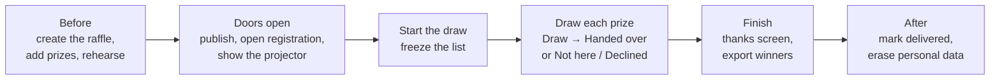
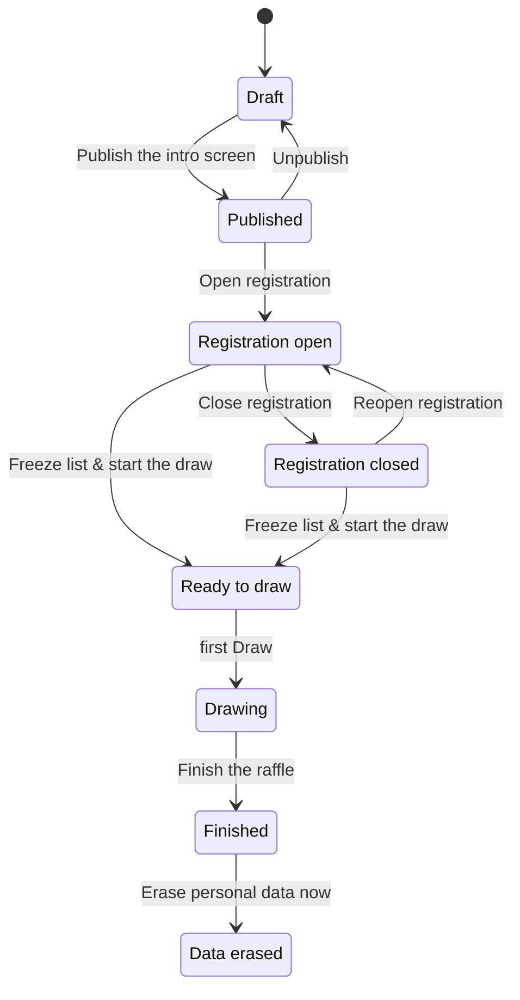

# Running a raffle

A walkthrough of one evening, from setting up to erasing data afterwards. It assumes a running Rafi. To deploy one,
see [Operations](../operations/overview.md). For the draw itself in detail, see [The draw](the-draw.md).

## The evening at a glance

Your screens:

| Screen | Where | Shown to |
|---|---|---|
| **Admin** | `/admin` | You. Keep it on a laptop or phone, never on the projector. |
| **Projector screen** | `/s/<slug>` ("Projector screen" button) | The room. It never shows emails or admin buttons. |
| **Participant page** | `/j/<CODE>` (the QR code) | Each attendee, on their phone |
| **Verification page** | `/v/<slug>` ("Verification page" button) | Anyone, once the list is frozen |

## The raffle's states

The admin shows a state badge and the next steps. Each state allows different things:

| State | Prizes and entrants editable | Phones can join | Draws |
|---|---|---|---|
| Draft, Published | yes | no | no |
| Registration open | yes | **yes** | no |
| Registration closed | yes | no | no |
| Ready to draw, Drawing | no (only withdraw an item) | no | **yes** |
| Finished, Data erased | no | no | no |

## Before the event

1. **Create a raffle** in `/admin`: give it a title.
2. **Settings:** the description for the intro screen, the event date, the organizer (named as data controller in
   the rules and privacy notice), a contact email for privacy requests, and any **additional rules**, one paragraph
   per line. Put any age limit there. Save the organizer, contact and rules as **your defaults** so the next raffle
   starts with them.
3. **Prizes:** add each prize with a quantity and, optionally, a sponsor. Each copy is drawn on its own, in any
   order you like during the draw.
4. **Rehearse.** Turn on **Test mode** in settings. A TEST badge shows on every screen, and the People tab offers
   **Add 25 fake entrants**, with generated names like "Brave Otter". Run through the draw on the projector.

> Rehearse on a copy: **Duplicate** (the raffle's ⋯ menu) copies prizes and settings but not entrants, and a raffle
> drawn in test mode stays a rehearsal: its verification page says **TEST MODE** for good. To rehearse on the raffle
> you'll run live, switch test mode off before the freeze: that removes every fake entrant. A raffle that isn't in
> test mode never freezes with fakes in it.

## When doors open

1. **Publish the intro screen.** Open the **Projector screen** on the venue's display, in fullscreen (which also
   keeps the screen awake). It shows the title, the prizes and "Registration opens soon".
2. **Open registration.** The projector now shows a QR code, the short join URL and code, a live entrant count and
   recent names, plus "No smartphone? Come to the organizer!".
3. Attendees scan and join with their email and a display name, which is optional: whoever leaves it blank gets a
   generated one, like "Brave Otter" (see [For participants](for-participants.md)).
4. While people join, use the **People** tab to:
   - **add someone without a smartphone** by name (email optional)
   - **hide** or **rename** a display name on screen with one tap (a troll, a typo). New names reach the projector
     after a 5 s delay.
   - **remove** duplicates
   - search by name, email or claim code

You can close and reopen registration as often as you like before the draw.

## Starting the draw

Press **Freeze list & start the draw** when everyone is in. It asks first, because this step is final:

- Registration closes for good. Latecomers can't be added.
- The entrant list is frozen into the **manifest** and published as a hash and a list of anonymous IDs. The
  **Verification page** link appears.
- Prizes are locked. From now on an item can only be **withdrawn**.
- Nobody leaves the list until the raffle is finished: the People tab can still **hide** or **rename** a name, and
  a drawn winner who doesn't want their prize is **Declined**. Asked to erase someone's data during the event? Hide
  their name now, and erase their personal data once the raffle is finished.
- The raffle is handed to the raffle engine.

If handing over fails (for example, the engine is briefly unreachable), the admin offers **Retry handing the list
to the raffle engine**. That picks up where it stopped. If nobody has entered, the freeze is undone.

## Drawing

Open the **Draw** tab. For each prize, in any order:

1. Press **Draw**. The projector shows "Locking in public randomness · drand round R" and a countdown of about 6 s,
   then the winner's name.
2. The admin shows the winner's **claim code**. The winner's phone shows **YOU WON!** with the same code.
3. When they come up and the codes match, press **Handed over**. If they're not in the room, press **Not here**. If
   they don't want it, press **Declined**. With either of those, they're out and the prize goes back to be drawn
   again.

[The draw](the-draw.md) covers every case, including what happens when drand can't be reached.

## Finishing

Press **Finish the raffle** when the prizes are handed out (or when you want to stop with some left). The projector
and phones show **Thanks for playing!** with the winners and a link to the verification page. Then:

- **Export winners (CSV)** from the ⋯ menu: entrant ID, name, email, source, claim code, outcome, prize, delivered,
  marketing consent.
- **End live updates** when the room empties. Phones and the projector stop following live, and the results stay on
  the pages. This also happens automatically a day after the finish.

## After the event

- **Mark delivered** (People tab) for prizes you send out later. Only a winner who claimed can be marked delivered.
- **Erase one entrant's personal data** (People tab) when someone asks.
- **Erase personal data now** (⋯ menu) once you no longer need names and emails. Names, emails and claim codes go,
  and the anonymous draw log stays verifiable. This can't be undone. There is no automatic erasure, so do it
  yourself. See [Privacy and abuse](../explanation/privacy-and-abuse.md).
- **Delete raffle** removes it entirely, including its draw log and therefore its verifiability.

## Checklist

- [ ] Prizes entered with the right quantities and sponsors
- [ ] Organizer, contact email and additional rules filled in
- [ ] Rehearsed on a duplicate in test mode, with the projector
- [ ] The projector screen in fullscreen, readable from the back of the room
- [ ] The venue wifi or mobile data reaches the server over HTTPS
- [ ] Someone ready to add people without a phone
- [ ] Nobody deploys while the raffle is live (see [Upgrades](../operations/upgrades.md))
