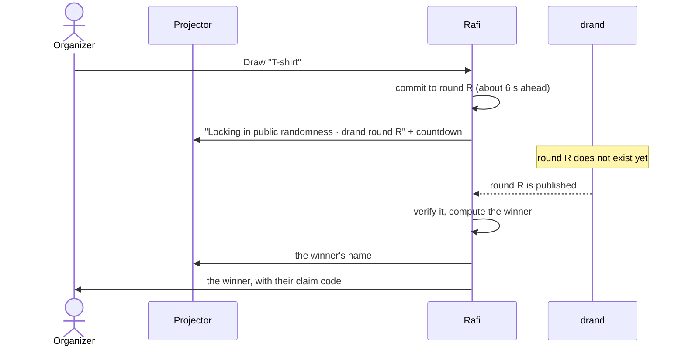
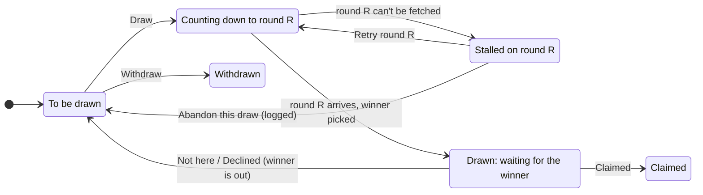

# The draw

What happens from **Freeze list & start the draw** to **Finish the raffle**, from the organizer's side. For why this
makes the result trustworthy, see [Why the draw is verifiable](../explanation/verifiability.md).

## In short

1. **Freezing** fixes who is in and what can be won, and publishes it.
2. **Each Draw** commits to a public drand randomness round a few seconds in the future, waits for it, and picks one
   winner from it with a public formula.
3. **You decide** what happened to each winner: claimed, not here, or declined. A no-show's prize is drawn again.
4. **Anyone can re-run** every draw on the verification page.

## 1. Freezing the list

**Freeze list & start the draw** turns the raffle's entrants and prizes into a **manifest**:

- every entrant, as a random anonymous ID (no names or emails)
- one **item** per copy of each prize ("3 × T-shirt" becomes three items)
- the draw algorithm (`rafi-draw-v1`) and the randomness source (drand quicknet)

The manifest and its hash are published on the verification page. From this moment nothing about who can win
changes, except through the public decisions below.

## 2. Drawing an item

Pick any item that is still **to be drawn** and press **Draw**. You choose the order live, and it doesn't matter to
the result: nobody knows what any future draw will pick.

1. **Commit.** Rafi picks the drand round that will be published about 6 seconds from now and records it. This
   happens *before* the round exists.
2. **Countdown.** The projector, every phone and your admin show "drand round R" with a countdown. During it, the
   **Draw** buttons are disabled: only one draw runs at a time.
3. **Reveal.** When round R is published, Rafi fetches it, checks its signature and computes the winner:
   `pool[uniform(SHA256(…randomness, manifest hash, draw number…))]`. The details are in the
   [reference](../reference/draw-algorithm.md).
4. **Winner.** The projector shows the winner's display name. The winner's phone shows **YOU WON!** with their claim
   code, and everyone else sees "Not this time". Your admin shows the winner's name, email and claim code.

### Who can be drawn

- **One win per person.** Once someone is drawn, they're out of the pool, whatever happens next.
- **Pass 2.** If there are more items than people, the pool runs dry. A second pass then draws from earlier winners
  who didn't forfeit, each at most once more.
- If nobody at all is left, Rafi refuses the draw, and the item stays to be drawn.

## 3. Deciding what happened

Each drawn item waits for your decision:

| Button | When | Effect |
|---|---|---|
| **Claimed** | The winner came up and showed the matching claim code | The item is theirs. Works even while another draw is counting down. Delivery is separate: **Mark delivered** in the People tab, once the prize reached them. |
| **Not here** | Nobody answers to the name | The winner is out of the raffle, and the item goes back to be drawn again with a new round |
| **Declined** | The winner doesn't want it | Same as Not here |
| **Withdraw** | An item that won't be given away (it broke, the sponsor didn't show) | The item is withdrawn. Only an item that is still to be drawn can be withdrawn. |

**Not here** and **Declined** ask for confirmation, can't be undone, and are recorded in the public log. They're
disabled while another draw is counting down, because they would change who that draw can pick.

People you added by hand (no phone) have no phone to show a code on, so confirm them by name.

## When drand can't be reached

Rafi waits up to 60 seconds past the round for its beacon, trying several public relays. If it still can't get it,
the draw **stalls**. Stalling is not an error that resets anything: the draw stays committed to round R.

The admin shows "Round R could not be fetched yet" with two options:

- **Retry round R.** This fetches the *same* round again, so retrying can never change the result. Use it when the
  venue's or the server's connection hiccuped.
- **Abandon this draw.** Use it only if drand stays unreachable. The item goes back to be drawn, and the next draw
  commits to a new round. The abandon is public: the verification page lists it, and anyone can see whom the
  abandoned round would have picked.

The projector shows "Still fetching drand round R" meanwhile.

> Why not just draw again with a new round? Because then a stall would be a way to reroll a result you didn't like.
> Committing to a round means sticking to it.

## Finishing

**Finish the raffle** ends the drawing. You can finish with prizes left, and they simply aren't given away. It isn't
available while a draw is counting down. Everyone sees **Thanks for playing!**, the winners, and a link to check the
draw.

## What everyone sees

| Moment | Projector | Winner's phone | Everyone else's phone |
|---|---|---|---|
| Ready to draw | "N prizes left", entrant count | "The draw is starting!" | "The draw is starting!" |
| Countdown | Prize, "drand round R", countdown | "Locking in public randomness" | same |
| Drawn | The winner's display name | **YOU WON!**, claim code, chime (and vibration on Android) | "Not this time", prizes left |
| Finished | **Thanks for playing!**, winners, verification link | Their prize | "Thanks for playing!" |

## See also

- [Verifying a draw](verifying-a-draw.md)
- [Why the draw is verifiable](../explanation/verifiability.md)
- [Troubleshooting](../operations/troubleshooting.md)
