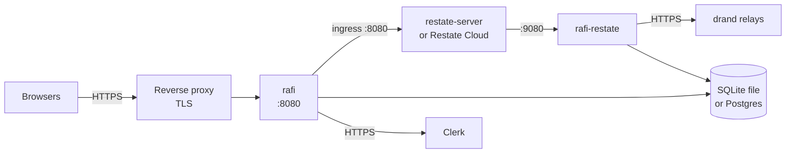
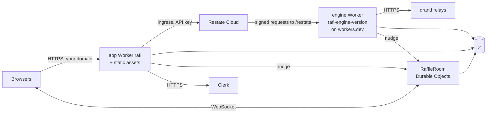

# Operations overview

How to run Rafi. This section is for whoever deploys and operates it. Organizers want the
[user guide](../guide/running-a-raffle.md).

## What you deploy

Every Rafi deployment has the same four parts:

| Part | Native (self-hosting) | Cloudflare Workers |
|---|---|---|
| **App**: admin, projector, participant and verification pages, APIs | `rafi` (`apps/rafi`) | The app Worker, `rafi` (`apps/worker-app`), which also hosts the live channels (`RaffleRoom`) |
| **Raffle engine**: runs the draws | `rafi-restate` (`apps/restate`) | The engine Worker (`apps/worker-engine`), one per release, `rafi-engine-<version>` on workers.dev |
| **Restate**: durable execution for the engine | A self-hosted `restate-server`, or Restate Cloud | Restate Cloud |
| **Database**: shared by the app and the engine | SQLite (one file, one machine) or PostgreSQL | D1 |

Plus two external services:

- **Clerk**, which authenticates organizers
- **drand**: the engine fetches public beacons from its relays over HTTPS

The app and the engine **share the database**. The app owns the schema and applies migrations on start. The engine
writes each raffle's state into it after every change.

## Native topology

Clients poll for updates. There is no push channel natively.

## Workers topology

Two Workers sharing the D1 database and the app's Durable Objects: the app Worker on your domain, and each
release's engine Worker, which Restate calls on workers.dev with signed requests and which stays until the
invocations that started on it have finished ([Cloudflare Workers](cloudflare.md#the-two-workers)). Your
repository's GitHub Actions workflow deploys both. Locally they are one Worker (`apps/worker`), the engine under
`/restate`.

## Choosing

| | Native | Workers |
|---|---|---|
| Status | Supported for self-hosting. No packaged images yet: build from source. | The production deployment; CI dry-deploys the production shape on every change. |
| Live updates | Polling (every few seconds) | Pushed over WebSockets |
| Database | SQLite or Postgres | D1, EU jurisdiction |
| Restate | Self-hosted or Cloud | Cloud |
| Scaling | One machine (SQLite) or more (Postgres) | Managed |

## Requirements that apply everywhere

- **HTTPS for phones.** Phones solve the join proof-of-work with WebCrypto, which browsers only offer on HTTPS and
  on `localhost`.
- **Outbound HTTPS from the engine to drand** (`api.drand.sh`, `api2.drand.sh`, `api3.drand.sh`,
  `drand.cloudflare.com` by default). Without it, draws stall.
- **The same drand chain** on the app (`RAFI_DRAND_CHAIN`) and the engine. The app checks this before starting a
  draw.
- **A release build.** Development features (`mock-drand`, `dev`) allow an unverifiable chain and disable auth.

## The operator's records

You are every organizer's processor (the data processing agreement in your terms) and the controller of their
accounts; your documents are set up in [Self-hosting](self-hosting.md#5-legal-documents-and-the-operator) or
[Cloudflare Workers](cloudflare.md#5-the-legal-documents-and-the-operator). What the software implies for your
records (not legal advice):

- **Your record of processing** as a processor (GDPR Art. 30(2)) lists, for the organizers you serve, the entrant
  data they provide, not only what entrants type in: the people an organizer adds, one by one or from a list
  (their names, emails and registration IDs, nothing else of the list, which is read in the organizer's browser),
  and the email keys and registration IDs of people removed at their request, kept until the list is frozen. The
  categories, the subprocessors and the erasure dates are in your privacy notice and in
  [Privacy and abuse](../explanation/privacy-and-abuse.md).
- **No DPIA for ordinary meetups.** Adding a meetup's guest list (names and emails for a prize draw, published as
  the entrants' names are, erased on the same dates) isn't the kind of processing Art. 35 asks an impact
  assessment for; an event that calls for one is the organizer's, the controller's, to assess. The terms keep out
  the lists that might: organizers warrant that a list reveals no special-category data (a support group's or a
  religious or political meeting's attendees) and that its people meet the age limit.
- **The terms changed on 2026-11-01** for people the organizer adds (§4 of the template: the data subjects and
  categories, adding as the organizer's instruction, the organizer's warranties, what the service receives from a
  list), and the privacy notice's "Two roles" with them. If your documents started from the templates, carry the
  change over, give them a new version (`RAFI_TERMS_VERSION`, `RAFI_PRIVACY_VERSION`), and, since the processing
  agreement changed, notify your organizers of it directly: publishing it isn't enough
  ([Privacy and abuse](../explanation/privacy-and-abuse.md#who-is-responsible)).

## Guides

- [Self-hosting](self-hosting.md): `rafi` and `rafi-restate` on your own machine
- [Cloudflare Workers](cloudflare.md)
- [Upgrades](upgrades.md): migrations, re-registering the engine, the deploy freeze
- [Troubleshooting](troubleshooting.md)
- [Runbook](runbook.md): the deploy preflight, rotating secrets, rolling back, the engine down during an event,
  backups and restore, a person's data request, a breach, monitoring, costs
- [Configuration reference](../reference/configuration.md)
- [Routes reference](../reference/routes.md)
