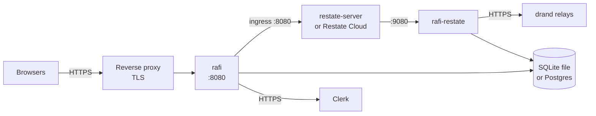
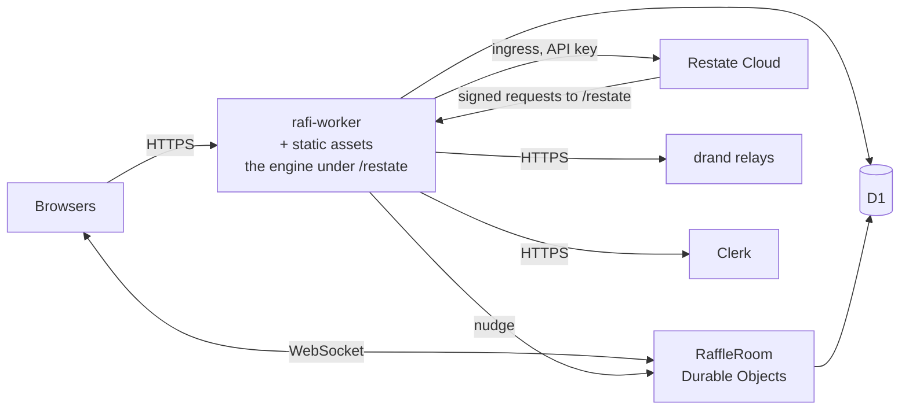

# Operations overview

How to run Rafi. This section is for whoever deploys and operates it. Organizers want the
[user guide](../guide/running-a-raffle.md).

## What you deploy

Every Rafi deployment has the same four parts:

| Part | Native (self-hosting) | Cloudflare Workers |
|---|---|---|
| **App**: admin, projector, participant and verification pages, APIs | `rafi` (`apps/rafi`) | `rafi-worker` (`apps/worker`), which also hosts the live channels (`RaffleRoom`) |
| **Raffle engine**: runs the draws | `rafi-restate` (`apps/restate`) | The same Worker, under `/restate` |
| **Restate**: durable execution for the engine | A self-hosted `restate-server`, or Restate Cloud | Restate Cloud |
| **Database**: shared by the app and the engine | SQLite (one file, one machine) or PostgreSQL | D1 |

Plus two external services:

- **Clerk**, which authenticates organizers
- **drand**: the engine fetches public beacons from its relays over HTTPS

The app and the engine **share the database**. The app owns the schema and applies migrations on start. The engine
writes each raffle's state into it after every change.

## Native topology

Clients poll for updates. There is no push channel natively.

## Workers topology

One Worker, two roles: the app's requests and Restate's share the isolate, the D1 binding and the Durable Object
binding; only the path tells them apart.

## Choosing

| | Native | Workers |
|---|---|---|
| Status | Supported for self-hosting. No packaged images yet: build from source. | The planned production target. Not deployed yet. |
| Live updates | Polling (every few seconds) | Pushed over WebSockets |
| Database | SQLite or Postgres | D1, EU jurisdiction |
| Restate | Self-hosted or Cloud | Cloud |
| Scaling | One machine (SQLite) or more (Postgres) | Managed |

## Requirements that apply everywhere

- **HTTPS for phones.** Phones solve the join proof-of-work with WebCrypto, which browsers only offer on HTTPS and
  on `localhost`.
- **Outbound HTTPS from the engine to drand** (`api.drand.sh`, `api2.drand.sh`, `api3.drand.sh`,
  `drand.cloudflare.com` by default). Without it, draws stall.
- **The same drand chain** on the app (`RAFI_DRAND_CHAIN`) and the engine. The app checks this before starting a
  draw.
- **A release build.** Development features (`mock-drand`, `dev`) allow an unverifiable chain and disable auth.

## Guides

- [Self-hosting](self-hosting.md): `rafi` and `rafi-restate` on your own machine
- [Cloudflare Workers](cloudflare.md)
- [Upgrades](upgrades.md): migrations, re-registering the engine, the deploy freeze
- [Troubleshooting](troubleshooting.md)
- [Configuration reference](../reference/configuration.md)
- [Routes reference](../reference/routes.md)
