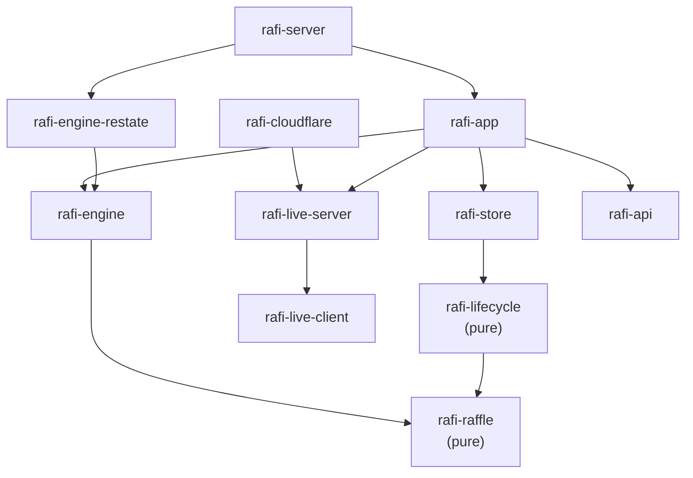

# Crates and apps

The workspace's layout. [Architecture](../explanation/architecture.md) explains how the pieces fit together.

This shows the main dependencies only.

## Libraries (`crates/`)

| Crate | Package | |
|---|---|---|
| [`raffle`](../../crates/raffle) | `rafi-raffle` | **The raffle**: the manifest, the state machine and its admission rule, the draw algorithm (`rafi-draw-v1`) and the verifier. Pure: no I/O. It also compiles to WebAssembly for the verification page. With the `mock-chain` feature, it includes the mock drand chain (development and tests). |
| [`lifecycle`](../../crates/lifecycle) | `rafi-lifecycle` | **The raffle's lifecycle in the app**. Pure. It covers the states and who may join, starting the draw (`start::next`), entrants' names and emails, settings, prizes as the raffle's items, and what phones see. |
| [`engine`](../../crates/engine) | `rafi-engine` | **The raffle engine's contract**: `Engine`, `Store`, `Observer`. Behind features: the drand client engines draw with (`drand`), an in-process engine for tests and development (`local`), and the engine conformance suite (`conformance`). |
| [`engine-restate`](../../crates/engine-restate) | `rafi-engine-restate` | **The engine on Restate**: the `Raffle` virtual object, the `EngineInfo` service, and `RestateClient`, the app's `Engine` over the ingress. See its [README](../../crates/engine-restate/README.md). |
| [`store`](../../crates/store) | `rafi-store` | **All SQL**, over SQLite, Postgres and D1. It includes the engine's write (`save_raffle`), the snapshot phones are shown, and the storage conformance suite. |
| [`live-client`](../../crates/live-client) | `rafi-live-client` | **What a phone sees and runs**: the participant view and channel, how clients follow, the page config. `card` is the Dioxus card. |
| [`live-server`](../../crates/live-server) | `rafi-live-server` | **The servers' side of live updates**: the `Notifier` a deployment pushes through (also the engine's `Observer`), `LiveUpdates`, the view built from a raffle, and the publish rule. |
| [`api`](../../crates/api) | `rafi-api` | **The contract between server and browser**: the views, and the admin API, declared once (`admin_functions!`). That declaration produces the server's `Admin` trait and `dispatch`, and the browser's client. |
| [`app`](../../crates/app) | `rafi-app` | **Every use case**: raffles, prizes, entrants, joining (rate limits, proof-of-work), the draw, the admin's reads, housekeeping. No HTTP. |
| [`server`](../../crates/server) | `rafi-server` | **The HTTP side**: an axum router (participant pages, public JSON, the admin API, auth). Both app hosts serve it. |
| [`cloudflare`](../../crates/cloudflare) | `rafi-cloudflare` | **The Cloudflare glue both Workers share**: the `RaffleRoom` Durable Object, its notifier, configuration from vars and secrets |

## Deployables (`apps/`)

| App | Package | |
|---|---|---|
| [`rafi`](../../apps/rafi) | `rafi` | The native app server: `rafi-server` plus the web app's files. For self-hosting. |
| [`worker`](../../apps/worker) | `rafi-worker` | The app on Cloudflare Workers: `rafi-server`'s routes, the housekeeping Cron, `RaffleRoom` |
| [`restate`](../../apps/restate) | `rafi-restate` | The native raffle engine: an endpoint serving `rafi-engine-restate`'s services to Restate. See its [README](../../apps/restate/README.md). |
| [`restate-worker`](../../apps/restate-worker) | `rafi-restate-worker` | The same services as a Cloudflare Worker, on D1. It nudges the live channel. |
| [`web`](../../apps/web) | `rafi-web` | The Dioxus 0.7 web app (admin, projector, verification page), bundled by `dx` |
| [`participant`](../../apps/participant) | `rafi-participant` | The participant page's WebAssembly and its JavaScript fallback |

## Everything else

| Path | |
|---|---|
| [`migrations/sqlite`](../../migrations/sqlite) | The SQLite (and D1) schema |
| [`migrations/postgres`](../../migrations/postgres) | The same for Postgres |
| [`testbeds/store-d1`](../../testbeds/store-d1) | `rafi-store-d1-check`: a Worker that runs the storage conformance suite on D1 |
| [`testbeds/cloudflare`](../../testbeds/cloudflare) | `rafi-cloudflare-check`: a Worker hosting `RaffleRoom` for the live channel's checks. Testbeds are never deployed: `scripts/workers-check.sh` runs them under `wrangler dev`. |
| [`tools/verify.py`](../../tools/verify.py) | The independent verifier (Python standard library only) |
| [`testdata`](../../testdata) | Shared test vectors (real quicknet beacons) |
| [`scripts`](../../scripts) | Build and check scripts: `participant.sh`, `app-assets.sh`, `workers-check.sh` |
| [`devenv.nix`](../../devenv.nix) | The development shell and `devenv up` (see [Getting started](../development/getting-started.md)) |
| [`docs/history`](../history) | Design notes from development. Historical: the code is the source of truth. |
