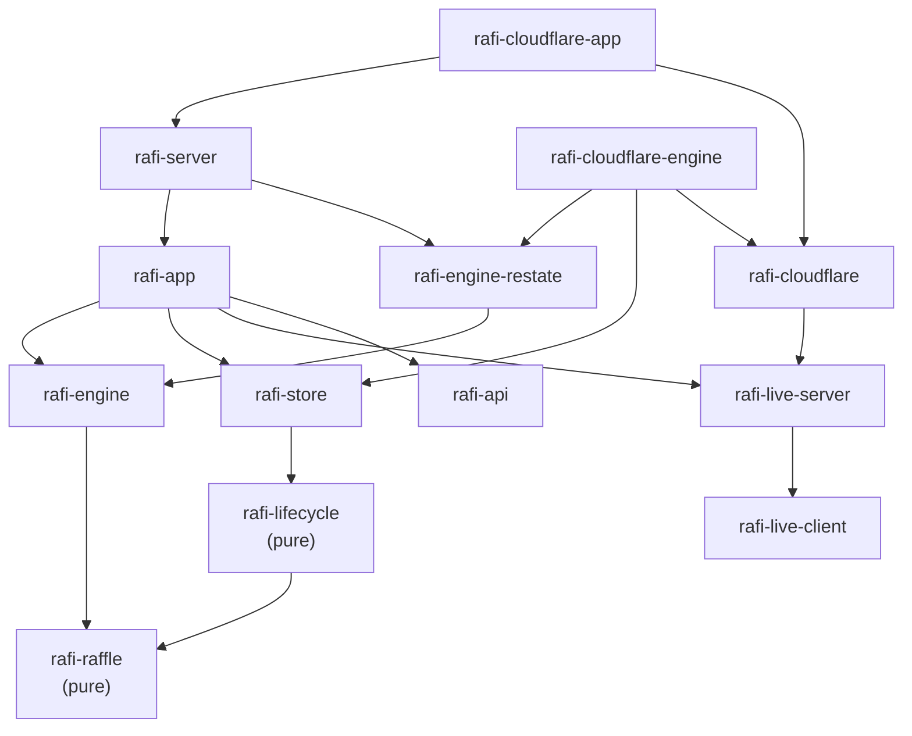

# Crates and apps

The workspace's layout. [Architecture](../explanation/architecture.md) explains how the pieces fit together.

This shows the main dependencies only.

## Libraries (`crates/`)

| Crate | Package | |
|---|---|---|
| [`raffle`](../../crates/raffle) | `rafi-raffle` | **The raffle**: the manifest, the state machine and its admission rule, the draw algorithm (`rafi-draw-v1`) and the verifier. Pure: no I/O. It also compiles to WebAssembly for the verification page. With the `mock-chain` feature, it includes the mock drand chain (development and tests). |
| [`lifecycle`](../../crates/lifecycle) | `rafi-lifecycle` | **The raffle's lifecycle in the app**. Pure. It covers the states and who may join, starting the draw (`start::next`), entrants' names and emails, how a list's names are shown and kept unique (`names`), settings, prizes as the raffle's items and how each reaches its winner (`prize::Delivery`), and what phones see. |
| [`engine`](../../crates/engine) | `rafi-engine` | **The raffle engine's contract**: `Engine`, `Store`, `Observer`. Behind features: the drand client engines draw with (`drand`), the mock chain for offline development (`mock-drand`), an in-process engine for tests and development (`local`), and the engine conformance suite (`conformance`). |
| [`engine-restate`](../../crates/engine-restate) | `rafi-engine-restate` | **The engine on Restate**: the `Raffle` virtual object, the `EngineInfo` service, and `RestateClient`, the app's `Engine` over the ingress. See its [README](../../crates/engine-restate/README.md). |
| [`store`](../../crates/store) | `rafi-store` | **All SQL**, over SQLite, Postgres and D1. It includes the engine's write (`save_raffle`), the snapshot phones are shown, and the storage conformance suite. |
| [`live-client`](../../crates/live-client) | `rafi-live-client` | **What a phone sees and runs**: the participant view and channel, how clients follow, the page config. `card` is the Dioxus card. |
| [`live-server`](../../crates/live-server) | `rafi-live-server` | **The servers' side of live updates**: the `Notifier` a deployment pushes through (also the engine's `Observer`), `LiveUpdates`, the view built from a raffle, and the publish rule. |
| [`api`](../../crates/api) | `rafi-api` | **The contract between server and browser**: the views, and the admin API, declared once (`admin_functions!`). That declaration produces the server's `Admin` trait and `dispatch`, and the browser's client. Also what the browser makes from a view, such as the paragraph an organizer sends the people they add (`paragraph_to_send`), natively tested. |
| [`app`](../../crates/app) | `rafi-app` | **Every use case**: raffles, prizes, entrants, joining (rate limits, proof-of-work), the draw, the admin's reads, housekeeping. No HTTP. |
| [`server`](../../crates/server) | `rafi-server` | **The HTTP side**: an axum router (participant pages, public JSON, the admin API, auth). Both app hosts serve it. |
| [`cloudflare`](../../crates/cloudflare) | `rafi-cloudflare` | **The Cloudflare glue** every Worker shares: the notifier over the raffles' Durable Objects (also the engine's observer), configuration from vars and secrets, the D1 binding, the `/restate` prefix. Behind features: phones' gate to their raffle's object (`connect`, a client of the objects like the notifier), the `RaffleRoom` Durable Object class (`object`: a `#[durable_object]` is exported from every Worker linking it, so only the Worker hosting the class turns it on, the live Worker in production) and the console's `tracing` subscriber (`log`) |
| [`cloudflare-app`](../../crates/cloudflare-app) | `rafi-cloudflare-app` | **The app on Workers**: `rafi-server`'s routes behind Clerk with the web app's shell, phones' sockets to their `RaffleRoom`, the operator's legal documents, if any, from the static files, the rate limits, the housekeeping run and `export_scheduled!` for the Cron's handler; built once per isolate. No `#[event]`: the Workers below export it |
| [`cloudflare-engine`](../../crates/cloudflare-engine) | `rafi-cloudflare-engine` | **The raffle engine on Workers**: the Restate endpoint over D1, the objects' binding and drand, built once per isolate from bindings and vars alone (no secrets, nothing of the app's: `just clippy-wasm` checks its tree) |

## Deployables (`apps/`)

| App | Package | |
|---|---|---|
| [`rafi`](../../apps/rafi) | `rafi` | The native app server: `rafi-server` plus the web app's files. For self-hosting. |
| [`worker`](../../apps/worker) | `rafi-worker` | Rafi on Cloudflare Workers in one Worker, for local development (`wrangler dev --env dev`, `just workers`, the devenv): the engine under `/restate`, the app everywhere else, the housekeeping Cron, `RaffleRoom`. Named `rafi` in Cloudflare. |
| [`worker-app`](../../apps/worker-app) | `rafi-worker-app` | Production's app Worker, `rafi-app` (an installation's name for it is the installation's identity in Restate): the app, the housekeeping Cron and the static files (`apps/worker`'s); `/restate` is a 404. Binds the live Worker's `RaffleRoom` class (`script_name = "rafi-live"`), which phones' sockets are forwarded to |
| [`worker-engine`](../../apps/worker-engine) | `rafi-worker-engine` | Production's engine Worker, one per release (`rafi-engine-v0-1-0` for 0.1.0, which `deploy.sh` registers with Restate and, once drained, removes from Restate and deletes (`deploy.sh cleanup`)): the Restate endpoint under `/restate`, nothing else. Binds the app's D1 database and the live Worker's `RaffleRoom` class (`script_name = "rafi-live"`); its configuration is vars (the Restate identity keys, drand), no secrets |
| [`worker-live`](../../apps/worker-live) | `rafi-worker-live` | Production's live Worker, `rafi-live` (the raffles' live channels): the `RaffleRoom` Durable Object class and its migrations, reading the app's D1 database; a 404 for every request, no address (no route, no `workers.dev`), no secrets. Deployed first in a deploy, and only when its code or `wrangler.live.toml` changed (`deploy.sh deploy-live`); a new one accepts the previous release's app and engine requests (`just clippy-wasm` checks it links nothing of theirs) |
| [`restate`](../../apps/restate) | `rafi-restate` | The native raffle engine: an endpoint serving `rafi-engine-restate`'s services to Restate. See its [README](../../apps/restate/README.md). |
| [`web`](../../apps/web) | `rafi-web` | The Dioxus 0.7 web app (admin, projector, verification page), bundled by `dx`. Its `import` module reads the organizer's lists in the browser (see [The web app](../development/web-app.md#adding-a-list)). |
| [`participant`](../../apps/participant) | `rafi-participant` | The participant page's WebAssembly and its JavaScript fallback |

## Everything else

| Path | |
|---|---|
| [`migrations/sqlite`](../../migrations/sqlite) | The SQLite (and D1) schema |
| [`migrations/postgres`](../../migrations/postgres) | The same for Postgres |
| [`testbeds/store-d1`](../../testbeds/store-d1) | `rafi-store-d1-check`: a Worker that runs the storage conformance suite on D1 |
| [`testbeds/cloudflare`](../../testbeds/cloudflare) | `rafi-cloudflare-check`: a Worker hosting `RaffleRoom` for the live channel's checks. Testbeds are never deployed: `scripts/workers-check.sh` runs them under `wrangler dev`. |
| [`tools/verify.py`](../../tools/verify.py) | The independent verifier (Python standard library only) |
| [`testdata`](../../testdata) | Shared test vectors (real quicknet beacons) |
| [`testdata/cloudflare-installation`](../../testdata/cloudflare-installation) | An installation on Cloudflare Workers, as a test fixture: the deploy template's three Workers' configurations (`wrangler.app.toml`, `wrangler.engine.toml`, `wrangler.live.toml`) and `VERSION` (the release it deploys), which the tarball check deploys (dry) and `scripts/workers-check.sh` compares with the production Workers'. The template itself, which operators create a repository of theirs from (with the legal documents, if any, and two GitHub Actions workflows, `deploy.yaml` and `restate-cleanup.yaml`, which verify a release and run its `deploy.sh`), is a template repository in the works (see [Cloudflare Workers](../operations/cloudflare.md)) |
| [`scripts`](../../scripts) | Check and release scripts: `workers-check.sh`, `cloudflare-tarball-check.sh` (a built tarball, dry-run deployed), `cloudflare-deploy.sh` (the deploy, which each release ships as its `deploy.sh`) and `cloudflare-deploy-test.sh` (its checks). The apps build with their own `justfile`s (`apps/web`, `apps/participant`, `apps/worker`, and `apps/worker-app`, `apps/worker-engine` and `apps/worker-live`, `build`, `dry-run` and `artifact`, what a release ships of each) |
| [`justfile`](../../justfile) | The checks, one recipe each; CI runs one job per recipe (see [Testing](../development/testing.md)) |
| [`devenv.nix`](../../devenv.nix) | The development shell and `devenv up` (see [Getting started](../development/getting-started.md)) |
| [`docs/plans`](../plans) | Specs for work in progress or just done, with the reasoning |
| [`docs/history`](../history) | Design notes from development. Historical: the code is the source of truth. |
