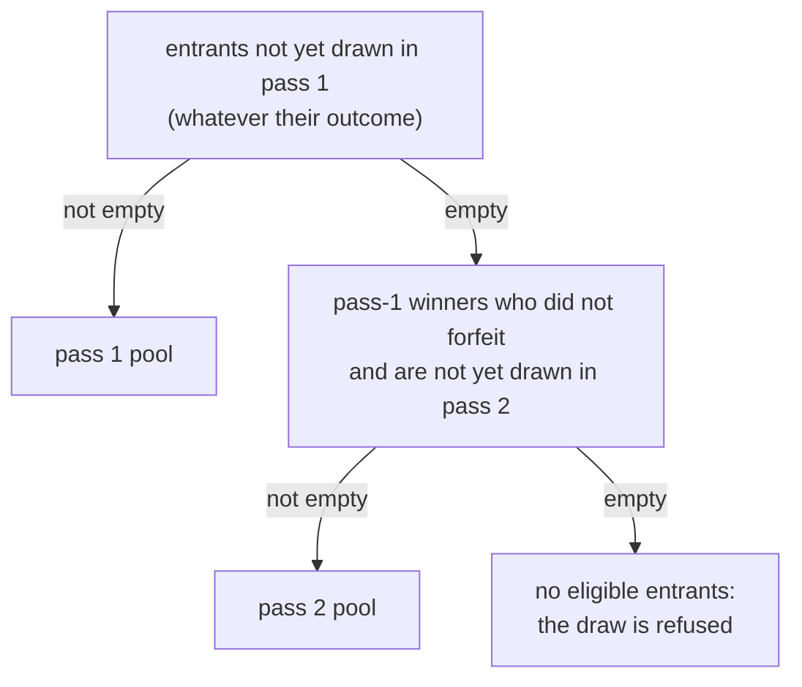

# Draw algorithm: `rafi-draw-v1`

This is the specification of how Rafi picks winners, written so that you can build an independent verifier from it.
For *why* the algorithm looks like this, see [Why the draw is verifiable](../explanation/verifiability.md).

The implementation is [`crates/raffle`](../../crates/raffle) (`algorithm.rs`, `manifest.rs`, `raffle.rs`,
`verify.rs`). [`tools/verify.py`](../../tools/verify.py) implements it a second time with only the Python standard
library. CI checks both against the same vectors.

## Notation

- `SHA256(x)` is SHA-256, and `‖` is byte concatenation.
- `BE_u64(n)` is `n` as 8 bytes, big-endian.
- Hashes and signatures are written as lowercase hex in JSON, and are hashed as raw bytes.

## Inputs

### Manifest

The manifest holds everything that decides the outcome except the randomness. It is written when the organizer
starts the draw, before any draw can be announced.

```json
{"algo":"rafi-draw-v1","raffle":"<raffle id>","beacon":{"drand":"<chain hash>"},"entrants":["<id>",…],"items":[{"id":"<item id>","name":"<name>"},…]}
```

| Field | Meaning |
|---|---|
| `algo` | Always `"rafi-draw-v1"`. It also serves as the domain-separation tag. |
| `raffle` | The raffle's ID. This ties the manifest to one raffle. |
| `beacon` | The randomness source: `{"drand": "<chain hash>"}`. Only a public drand chain is publicly verifiable. |
| `entrants` | The entrant IDs: random 128-bit values in lowercase hex, **sorted, deduplicated and lowercase**. Names and emails are not included. |
| `items` | One item per copy of a prize, each with a unique `id` and a `name`. |

The fields always appear in this order, and the manifest has no maps or floats. That makes its serialization
canonical. Verifiers **must not re-serialize** the manifest: the exact published string is what gets hashed.

A manifest is valid when:

- `algo` is `rafi-draw-v1`
- there is at least one entrant and at least one item
- the entrants are sorted, unique and lowercase
- the item IDs are unique

```
manifest_hash = SHA256(manifest)                 the published string's UTF-8 bytes
```

### Beacon

Every draw commits to one round `R` of the manifest's drand chain. The engine commits to the first round published
at least the lead (6 s by default) after the draw was requested. A round's beacon carries a BLS `signature`, which
must verify against the chain's public key:

```
randomness = SHA256(signature)                   the signature's raw bytes
```

The default chain is quicknet:

| | |
|---|---|
| Chain hash | `52db9ba70e0cc0f6eaf7803dd07447a1f5477735fd3f661792ba94600c84e971` |
| Genesis | 1692803367 (Unix time) |
| Period | 3 s |
| Scheme | `bls-unchained-g1-rfc9380` |
| Relays | `api.drand.sh`, `api2.drand.sh`, `api3.drand.sh`, `drand.cloudflare.com` |

## Selection

`k` is the draw number, starting at 1. It increases only when a draw completes, so no-show redraws count. Retrying
a stalled draw keeps its `k`. After an abandon, the next draw reuses the abandoned draw's `k` with a new round.

```
seed_k      = SHA256("rafi-draw-v1" ‖ randomness ‖ manifest_hash ‖ BE_u64(k))
rand_u64(c) = BE_u64(SHA256(seed_k ‖ BE_u64(c))[0..8])        c = 0, 1, 2, …
uniform(n)  : limit = 2^64 − (2^64 mod n)
              take rand_u64(c) for c = 0, 1, … until one is below limit; return it mod n
winner_k    = pool_k[uniform(|pool_k|)]
```

Rejection sampling means there is no modulo bias. The algorithm needs nothing but SHA-256. It deliberately avoids
general-purpose random number generators, whose output isn't guaranteed to stay the same across versions and
languages.

## Pools

`pool_k` is a list of entrant IDs in manifest order (sorted). It depends only on the completed draws before draw `k`:



- **Pass 1:** every entrant not yet drawn in pass 1, whatever the outcome of their draw. This is the
  one-win-per-person rule: being drawn takes you out of pass 1, even if you then forfeit.
- **Pass 2:** only once pass 1 is exhausted, which means there are more items than people. It holds the pass-1
  winners who didn't forfeit and haven't been drawn in pass 2 yet.
- A **forfeit** is a draw resolved `not_here` or `declined`.

## The event log

A raffle is its manifest plus an append-only event log. The verifier replays the log through the raffle's own
transitions. Each event is a JSON object with a `type` tag:

| `type` | Fields | Meaning |
|---|---|---|
| `announced` | `k`, `item`, `round`, `round_time` | Draw `k` committed to drand round `round`, which is published at Unix time `round_time` |
| `drawn` | `k`, `item`, `round`, `signature`, `randomness`, `pass`, `pool_size`, `index`, `entrant` | The round's beacon picked `pool[index]` |
| `stalled` | `k`, `item`, `round`, `reason` | The round's beacon couldn't be fetched or verified (yet). The draw stays pending on the same round. |
| `abandoned` | `k`, `item`, `round`, `reason` | The organizer abandoned the pending draw, and the item can be drawn again |
| `resolved` | `k`, `resolution` | `claimed`, `not_here` or `declined` |
| `voided` | `item` | The item was withdrawn |
| `finished` | | The raffle ended |

These rules hold, and the replay enforces them:

1. At most one draw is pending at a time. A `drawn` event must settle the pending draw **on its announced round**.
2. While a draw is pending, nothing may change its inputs. Other draws, forfeits (`not_here`, `declined`), voiding
   its item and finishing are all refused. A claim (`claimed`) is allowed, because it can't change the pool.
3. A pending draw leaves only through `drawn` (its own round) or an explicit `abandoned`. A `stalled` event leaves it
   pending.
4. Only an item that is available can be drawn or voided. Only a drawn item can be resolved.

## `verify.json`

`GET /api/r/<slug>/verify.json` publishes everything a verifier needs once the list is frozen:

```json
{
  "title": "…",
  "state": "drawing",
  "test_mode": false,
  "manifest": "<the canonical manifest string, exactly as hashed>",
  "manifest_hash": "<hex>",
  "events": [ … ],
  "names": [["<entrant id>", "<display name>"], …]
}
```

`names` lets people check that they are in the list: hidden names show as `★ ★ ★`. An entrant whose personal data
is erased is no longer in it (their ID stays in the manifest), so once the organizer erases everyone's, it is
empty. `test_mode` is `true` for a rehearsal, whose entrants may be fakes.

## Verification

A log verifies when all of these hold:

1. `SHA256(manifest)` equals the published `manifest_hash`.
2. The manifest is valid and canonical, and its chain is a public drand chain the verifier knows.
3. Every `drawn` beacon's BLS signature verifies against that chain for its round, and
   `randomness = SHA256(signature)`.
4. Replaying every event through the rules reproduces it exactly: the same pass, pool size, index and winner.

For each `abandoned` draw, a verifier can show whom the committed round would have picked: fetch the round, then
apply the selection to the pool as it stood.

## Test vectors

[`testdata/draw-vectors.json`](../../testdata/draw-vectors.json) holds `select` vectors (`randomness`,
`manifest_hash`, `k`, `pool_size` → `index`) and a whole `scenario` (`manifest`, `manifest_hash`, `events`) built
from real quicknet beacons ([`testdata/quicknet-beacons.json`](../../testdata/quicknet-beacons.json)). An
independent implementation should reproduce them all:

```sh
python3 tools/verify.py --vectors testdata/draw-vectors.json
```
